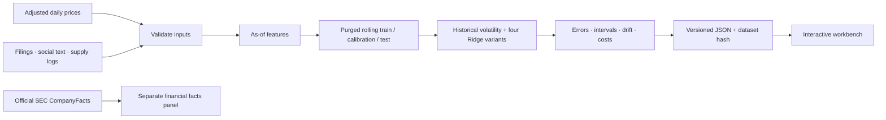

# FinScope

**Evidence-Grounded Financial Risk Lab · Leon Wang**

[Open the interactive workbench](https://leon1111-wgl.github.io/finscope/) · [Portfolio](https://leon1111-wgl.github.io/leon1111-wgl/) · [Methodology](docs/METHODOLOGY.md) · [Research](docs/RESEARCH.md)

A supplier reports a delay on Monday. Your feed receives it on Tuesday. Can a Monday forecast use it? FinScope makes that question visible, then applies it to financial disclosures, social text and rolling model evaluation.

Explore 5- and 20-session volatility forecasts, inspect the evidence available at a historical date, compare five fixed model variants, and change transaction costs. Every result connects to a dated information set and a downloadable experiment record.

The public workbench uses **fictional prices and authored events**. A separate panel displays real SEC facts with filing links and retrieval hashes. Those facts are never joined to the fictional market simulation. Local imports keep their own provenance and remain marked **unverified**.

## What you can do

| View | Research question |
| --- | --- |
| Overview | What did the model forecast, and which outcomes had matured by this date? |
| Evidence | Was each filing, social signal or supply event available and ingested in time? |
| Risk Lab | Does adding text and alternative data improve on the simple baseline? |
| Strategy | What happens after delayed execution, fees and slippage? |
| Data & Audit | Can I inspect the dataset hash, training splits, inputs and saved runs? |
| Research | Which primary studies informed the design, and what is actually implemented? |

The relationship graph describes supplied connections. It is not a trained graph neural network. The sentiment feature is an inspectable English word list. It is not an LLM.

## Run locally

Use Python **3.12**, the tested environment. Run commands from the cloned repository. The full lock includes the optional SEC parser and local service.

```bash
git clone https://github.com/leon1111-wgl/finscope.git
cd finscope
python3.12 -m venv .venv
source .venv/bin/activate
python -m pip install -r requirements.lock
python -m pip install --no-deps -e .
python -m uvicorn finscope.api:app --host 127.0.0.1 --port 8772 --workers 1
```

Open **http://127.0.0.1:8772**. Data & Audit enables CSV/JSON upload, model fitting, saved-run history and reload. Files stay in the local process and ignored `runs/` directory. Stop the service with Ctrl+C.

GitHub Pages hosts a static explorer. It cannot execute Python or train new experiments. To inspect it without installing Python dependencies, serve `web/` with any static HTTP server.

### Inputs

Prices use daily U.S. equity sessions. `close` must already be adjusted for corporate actions:

```csv
date,ticker,close,volume
2024-01-02,EXAMPLE,100.25,250000
2024-01-03,EXAMPLE,101.10,265000
```

Two rows illustrate the schema, not sufficient training history. Compact 5-session experiments need at least 176 sessions per ticker; 20-session experiments need 221. Longer datasets switch to larger training windows. Use the downloadable demo inputs for a full runnable example.

Events are optional (`[]`). A supply event can look like this:

```json
[{
  "id": "shipment-001",
  "ticker": "EXAMPLE",
  "kind": "supply",
  "event_time": "2024-01-02T09:00:00Z",
  "available_at": "2024-01-02T10:00:00Z",
  "ingested_at": "2024-01-03T08:00:00Z",
  "text": "A shipment is expected three days late.",
  "source": "Authorized internal shipment log",
  "delay_days": 3,
  "relationship": "SUPPLIER"
}]
```

That event first enters the January 3 information set. Timestamp assertions supplied by the importer are not independently certified. Use only data you may process; review redistribution rights before publishing derived artifacts. [Full data contract](docs/DATA_CONTRACT.md).

### Build and verify

```bash
python scripts/build_demo.py       # offline: both horizons and downloadable inputs
python -m pytest -q
node --test tests/ui.test.mjs      # Node 22; no npm dependencies
```

For a private command-line experiment:

```bash
python -m finscope.cli run --prices local-data/prices.csv \
  --events local-data/events.json --horizon 5 --output runs/research.json
```

CLI outputs use your chosen filename; API history recognizes only its generated run IDs. Do not write private reports under `web/` or `data/demo/`.

## How it works



## Original contribution and scope

FinScope combines an original evidence schema, timing checks, feature/evidence views, reproducible ablations, local experiment service and interactive audit workflow. It uses scikit-learn for established estimators and preprocessing. EdgarTools has been executed as a separate parser check on the SEC snapshot. It does not claim to invent Ridge regression, TF-IDF, point-in-time analysis or prediction intervals.

This release supports daily risk research. Intraday order books, learned financial networks, calibrated multilingual sentiment, live feeds and broker execution remain future work. Additional features do not consistently win in the demo; all predetermined variants remain visible.

[Methodology and equations](docs/METHODOLOGY.md) · [Operations and limits](docs/OPERATIONS.md) · [Contribution map](docs/CONTRIBUTIONS.md) · [Third-party notices](THIRD_PARTY_NOTICES.md)

Original code and authored synthetic fixtures: [MIT license](LICENSE), © 2026 Leon Wang. Third-party software, data and future model weights retain their own terms.
