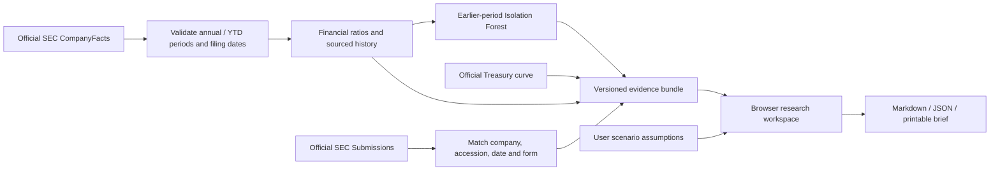

# FinScope — From profit to proof

**Earnings Quality & Financial Resilience · Leon Wang**

[Use it online](https://leon1111-wgl.github.io/finscope/) · [Worked case](docs/CASE_STUDY.md) · [Product rationale](docs/PRODUCT.md) · [Model card](docs/RESEARCH_MODEL.md) · [Forecasting lab](https://leon1111-wgl.github.io/finscope/lab.html)

Earnings have grown. Does that growth have cash-flow support? What would a weaker operating year change? FinScope helps students, independent researchers and junior analysts turn those questions into a source-linked financial review they can share.

**Open the website, choose a company, test an assumption and download a brief. No account, installation or API key is needed to use the public workspace.**

## What you can do today

| Step | Practical output |
| --- | --- |
| Review the evidence | Annual profit/cash trends, liquidity ratios, exact SEC facts and filing links |
| Check what changed | Newer fiscal YTD revenue, profit and operating cash flow versus the same period last year |
| Explain the cash gap | Selected non-cash and working-capital adjustments, visible remainder, source links and a downloadable waterfall |
| Compare companies | Six financial profiles with explicit fiscal dates and missing-data labels |
| Inspect AI triage | Historical-profile anomaly percentile plus underlying ratios and training boundaries |
| Test assumptions | Browser calculations for revenue, margin, refinancing costs and collection delays |
| Take your brief | Editable Markdown, source-rich JSON, print/PDF and a shareable research view |

The public universe is **AAPL, MSFT, NVDA, AMZN, GOOGL and META**. Official Treasury observations provide rate context, with a separate hypothetical bond sensitivity calculator. The workspace uses real annual disclosures plus matched interim checkpoints; it is not a live-price terminal.

## The project story

The original FinScope lab made information timing and model comparisons visible, but its fictional scenario could not answer a real-company review question. A separate table of SEC facts was not enough. The missing piece was a complete path from a question to evidence, assumptions and a portable result.

This release adds that path. Financial statement rules define the inputs. An established unsupervised model helps prioritize unusual profiles. Transparent scenario formulas expose what follows from each assumption. The export carries the data version and source trail so another reader can reproduce the review.

This is an original research workflow built on open-source tools and public data. It does not claim a new anomaly-detection algorithm or measured investment alpha.

## Try a complete case

1. Open the workspace with Microsoft selected.
2. Compare annual net income and operating cash flow. Open the exact history and filing evidence.
3. Compare profiles, paying attention to differing fiscal dates.
4. Select **Test assumptions → Try a downside case**. The preset assumes revenue −10%, margin −2 percentage points, $10B refinanced at +100 basis points and collections delayed by 15 days. Replace these assumptions with your own.
5. Select **Take your brief** and export Markdown or JSON. Add a human conclusion after reading the latest quarterly filing and management discussion.

[Read the worked numbers, interpretation and follow-up questions](docs/CASE_STUDY.md).

Evidence tables include **Read 10-K / Read 10-Q** links to the matched SEC document, a **Filing index** backup and the exact XBRL tag. The same sources travel with the exported brief. [How filing links are verified](docs/FILING_EVIDENCE.md).

To investigate a newer operating-cash gap, select **NVDA → Review the evidence** and open the fiscal YTD checkpoint. Follow the profit-to-cash waterfall, compare the prior period and expand the source/sign detail. Download the SVG for a presentation or include the full comparison in your research brief. [Cash-flow bridge method and limits](docs/CASH_FLOW_BRIDGE.md).

## Architecture



Python validates the evidence and computes saved anomaly profiles. GitHub Pages serves the bundle; JavaScript performs the scenario calculations locally in the visitor's browser. No visitor data is sent to a model API. GitHub Actions refreshes official sources on weekday mornings UTC and deploys only after validation. The banner reports actual dates; a snapshot older than four days is visibly marked overdue.

## Reproduce locally

Tested Python version: **3.12**. Frontend: native JavaScript modules, no npm build.

```bash
git clone https://github.com/leon1111-wgl/finscope.git
cd finscope
python3.12 -m venv .venv
source .venv/bin/activate
python -m pip install -r requirements.lock
python -m pip install --no-deps -e .
python -m http.server 8773 --bind 127.0.0.1 --directory web
```

Open **http://127.0.0.1:8773**. The committed public snapshot works offline after loading. To rebuild from official sources, use a SEC-identifying User-Agent with your own contact address:

```bash
export SEC_USER_AGENT='Your Name your-contact@example.com'
python scripts/build_research.py
# Rebuild from the downloaded raw files and their original source metadata:
python scripts/build_research.py --offline
python -m pytest -q
node --test tests/*.test.mjs
```

For a fork, configure the repository variable `SEC_USER_AGENT` and enable GitHub Pages via Actions. [Refresh operations](docs/ONLINE_OPERATIONS.md). A successful refresh commits the derived JSON and archives public raw sources for 30 days. Git history preserves the compact evidence snapshots beyond that artifact-retention period.

## AI role and evidence limits

The Isolation Forest detects unusual combinations of six financial ratios. It trains on eligible earlier company-years, with current target periods excluded. A score is an investigation cue, not a probability of default, fraud detector or investment recommendation. The transparent ratios are always available as a baseline.

Historical views reconstruct filing-day eligibility from currently retrieved SEC data. They are not a certified historical raw archive. The selected companies are survivors, fiscal calendars differ, business regimes change and some standard tags are missing. The separate YTD checkpoint adds newer standard-tag revenue, profit and cash flow. It does not provide complete quarterly coverage or trailing-twelve-month values. Read the filing notes for explanations. [Interim matching method](docs/INTERIM_CHECKPOINT.md). [Full model card](docs/RESEARCH_MODEL.md).

## The separate forecasting research track

[Open the forecasting lab](https://leon1111-wgl.github.io/finscope/lab.html) for fictional daily volatility experiments, source-timing audits, five fixed model variants and transaction-cost sensitivity. Social sentiment and supply-chain examples belong to that synthetic track; they are not invented events about the real companies above.

Local CSV/JSON fitting remains available through the loopback service. Start `python -m uvicorn finscope.api:app --host 127.0.0.1 --port 8772 --workers 1` and open **http://127.0.0.1:8772/lab.html**. [Lab setup and input contract](docs/FORECASTING_LAB.md) · [Forecasting methodology](docs/METHODOLOGY.md) · [Research foundations](docs/RESEARCH.md).

## Foundations and contribution

Official [SEC CompanyFacts and Submissions](https://www.sec.gov/search-filings/edgar-application-programming-interfaces) supply financial facts and matched filing-document metadata. The [Treasury curve dataset](https://catalog.data.gov/dataset/interest-rate-statistics-daily-treasury-yield-curve-rates) is listed as CC0. scikit-learn supplies established estimators. EdgarTools was used as an independent parsing check in the original lab.

Original contributions: fiscal-period matching, dated evidence views, training-boundary safeguards, scenario UX and math, reproducible briefs and the integrated public delivery pipeline. [Contribution map](docs/CONTRIBUTIONS.md) · [Third-party notices](THIRD_PARTY_NOTICES.md).

Code and authored examples: [MIT](LICENSE), © 2026 Leon Wang. Third-party data and software retain their terms.
